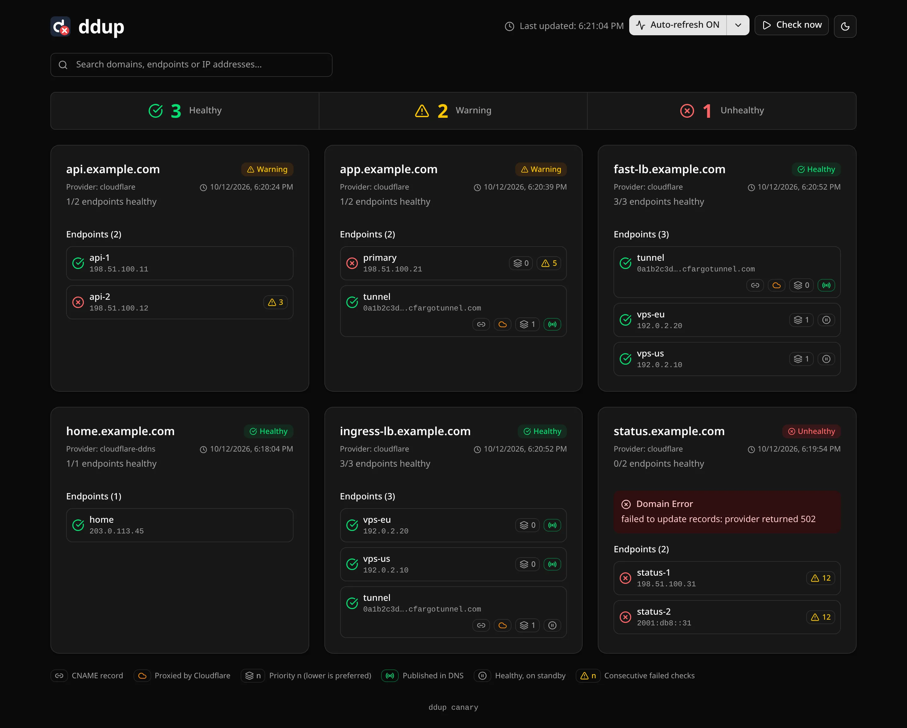
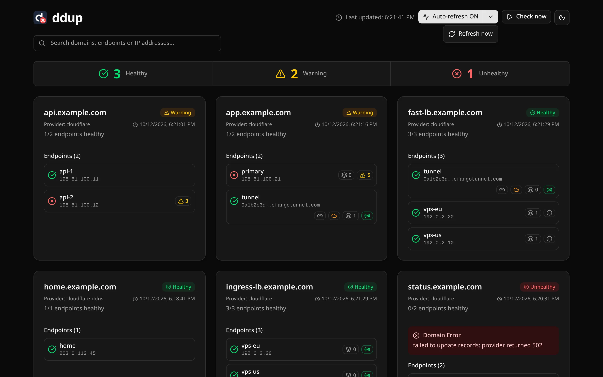
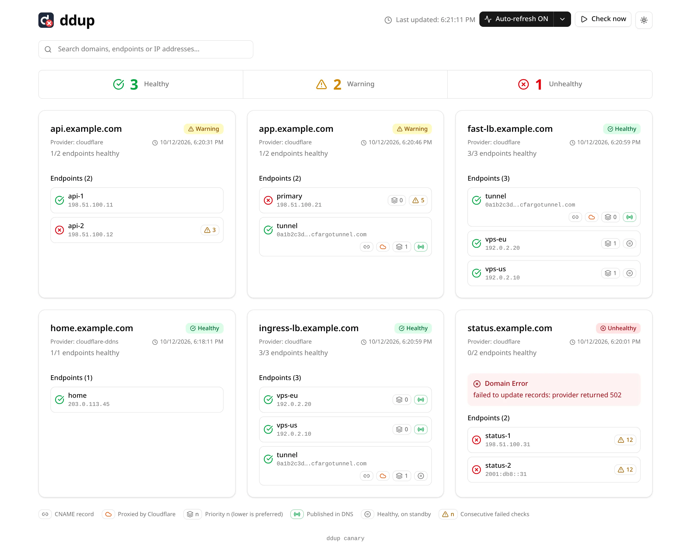
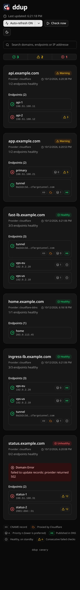

# What this fork adds

This fork of [ItalyPaleAle/ddup](https://github.com/ItalyPaleAle/ddup) carries features that are not upstream, or not yet.
This branch is upstream `main` (`1ade733`, which already has the version footer, `DEVELOPMENT.md` and the Makefile targets) with the open upstream pull requests [#37](https://github.com/ItalyPaleAle/ddup/pull/37) to [#40](https://github.com/ItalyPaleAle/ddup/pull/40) merged, and the fork-only features below on top. What those pull requests add (the endpoint history, `cname` and `proxied`, the IP lookup over HTTPS and the notifications) is not listed here.
Everything shown below is sample data: `example.com` names, documentation IP addresses (`192.0.2.0/24`, `198.51.100.0/24`, `203.0.113.0/24`, `2001:db8::/32`), and a made-up tunnel ID.
[`UPSTREAM.md`](UPSTREAM.md) tracks each feature below against its upstream PR or decision.
[`config.sample.yaml`](config.sample.yaml) documents every option.

## Dashboard

Each endpoint row shows what ddup publishes and why. Upstream shows the endpoints of a domain by address; the rows here are fork-only for now (upstream issue [#27](https://github.com/ItalyPaleAle/ddup/issues/27), after the features above). The status API carries what the rows need: `name`, `priority` and `active` (published in DNS), next to the upstream fields `type`, `proxied` and the times.

- **Name and address.** The name of the endpoint is the main label, with its address below. An endpoint with no name shows its address. The rows are ordered by priority.
- **Priority and standby.** In a domain with more than one priority, the row shows the endpoint's priority, and whether it is published in DNS or healthy on standby (see `fast-lb` and `ingress-lb`). A healthy endpoint that is published in DNS shows the published chip also in a domain with one priority, so the rows look the same in every domain. The selection of the lowest priority is upstream's; the display and the published set in the status API are not.
- **A failed DNS update.** When the provider can't be updated, an endpoint that should be published but is not shows "Not published", and one that should be removed but still is in DNS shows "Still in DNS" (`pending` in the status API: `add` or `remove`). The published chip is not shown for the first. The domain shows the provider error.
- **Failed checks and domain errors.** A warning triangle with the number of consecutive failed checks. A domain that can't be updated shows the provider error (`status`).
- **Legend.** The footer explains every icon, above the version of the build.

The rows show status, not configuration: whether an endpoint is a CNAME or proxied by Cloudflare is not shown, and the endpoint name is the place for it if wanted. Every chip has an icon with its own shape and a text for screen readers and the tooltip, so nothing depends on color alone.
The **History** button on the line that counts the healthy endpoints, the version footer and the reload when the server is upgraded are upstream's.

### Theme

The last button in the header cycles the theme between system, light and dark, and the choice is remembered in the browser. Upstream declined it ([#20](https://github.com/ItalyPaleAle/ddup/pull/20)): it stays in the fork on purpose.

### Light theme

### Small screens

## Not visible in the dashboard

- **Leader election.** With `leaderElection.enabled`, several replicas run on Kubernetes: all of them check health, but only the one holding a Lease updates DNS and sends notifications. Standby replicas forward API requests to the leader, so every dashboard shows the leader's view, and answer with their own build header so a rolling update does not make the page reload. Upstream declined it ([#30](https://github.com/ItalyPaleAle/ddup/issues/30)): fork-only on purpose. The README describes what happens to notifications when the leader changes.

## Detailed notifications

The notifications of upstream PR [#40](https://github.com/ItalyPaleAle/ddup/pull/40) replaced the fork's webhook templates, and their messages lost what the fork used to send. `notifications.detail` (on by default here, `false` to turn it off) brings it back for ntfy (a webhook with `format: ntfy`), the other webhooks and email:

- Endpoint names instead of addresses in the titles of `dns_updated` (`example.com now points to server1, server2`) and `dns_update_failed` (`DNS update failed for example.com (wanted server1)`). An endpoint whose name is only the default (its health-check URL, which can contain a token) is shown by its address in titles and in the body; a name that looks like a URL or has credentials is never used.
- A green, yellow or red circle for the status of the domain in the title and in the `Status` line (ntfy keeps it in the tag only, so it isn't shown twice).
- The error of the latest check of each unhealthy endpoint, without the endpoint's URL.
- On domains with more than one priority, the priority of each endpoint, `healthy (standby)` for a healthy endpoint that is not published, and `Priority: <new> (was <old>)` when a `dns_updated` changes tier.

The README shows an example under [Detailed messages](README.md#detailed-messages).
Nothing changes in when notifications are sent: only the leader sends them, through the same queues.

**How it is kept apart.** The code is in `pkg/notify/detail.go` and `pkg/healthcheck/notifydetail.go`, with their tests. Upstream files have one-line hooks only: the `Detail` field of `notify.Event`, the `ntfyTitle` of `message`, `Notifier.message` and `Notifier.redactDetail` in `notifier.go`, the `notifyDetail` field of `domainChecker` set in `healthchecker.go` and read in `HealthChecker.notify`, and the `Detail` setting of `ConfigNotifications` with its default in `GetDefaultConfig`. A configuration built in code (as in upstream's tests) has `Detail: false`, so upstream's message tests run unchanged.

**How to drop it.** Delete those two files and their tests, then remove the hooks listed above.
Configurations that set `detail` would then fail to load, because unknown keys are rejected.

**Upstreaming.** A candidate once [#40](https://github.com/ItalyPaleAle/ddup/pull/40) is merged: the names in titles, the errors and the tiers are the most useful part, and upstream may prefer them without a setting. The name logic is self-contained: `EndpointDetail.Label` is filled from `displayName` (the configured name, empty for the default) and `Detail.names` falls back to the address, so upstream could fold `Label` into `EndpointState` directly.

## Leader election

By default ddup is a single instance. On Kubernetes you can run several replicas with `leaderElection`: all of them run the health checks and keep their own state, but only the leader updates DNS and sends notifications, so a replica that takes over finds a warm state. The leader is decided with a `Lease` object.

- `enabled`: Enable leader election (disabled by default)
- `name`: Name of the Lease (defaults to `ddup`)
- `namespace`: Namespace of the Lease (defaults to the namespace of the pod)
- `identity`: Unique ID of the replica (defaults to `$POD_IP`, then `$POD_NAME`, then the hostname)
- `leaseDuration`, `renewDeadline`, `retryPeriod`: Timing of the election (defaults to `15s`, `10s` and `2s`; each must be longer than the next). A new leader is elected within about `leaseDuration` after the old one crashes, and right away when the leader shuts down cleanly

The service account of the pod needs the permission to `get`, `create` and `update` Leases in the namespace.

What changes with several replicas:

- Only the leader calls the DNS provider and sends notifications. A standby logs `Not the leader, skipping DNS update` at the debug level.
- When a replica becomes the leader, it publishes the current records again for every domain, in case the old leader stopped in the middle of a change. If the records are already right nothing changes, and no `dns_updated` notification is sent.
- A domain with no healthy endpoints is announced once. The standbys note the outage without announcing it, so a new leader that takes over during the outage does not send `all_unhealthy` a second time. If the old leader stopped before announcing the outage, nobody announces it, but the recovery is still reported by `dns_updated`.
- A `dns_update_failed` notification is sent once for each distinct error by the leader that saw it. A new leader sends its own if it hits the same error.
- Every replica makes its own health checks, so the `since`, `sinceStart` and `lastFailure` times of an endpoint are when that replica saw the change, and `failureCount` is its own count.
- The API requests (`/api/status`, `/api/check`) that a standby receives are forwarded to the leader, so everyone sees the leader's view and "Check now" runs where it matters. Forwarding needs the identity to be the IP address of the pod, and only works to the port of `server`. If the leader is unknown or can't be reached, the standby answers with its own view. The page and `/healthz` are always served by the replica that receives the request.
- The forwarded response carries the `X-Ddup-Build` header of the replica that forwarded it, not the leader's. During a rolling update the leader can run an older build than the standby that served the page, and the dashboard must compare its own build with the one that served it: with the leader's build it would reload the page for a build that the next request could not give it. The dashboard also limits how often it reloads for the same build.

## Build workflow

`.github/workflows/build-and-publish.yaml` builds only the Linux platforms of the container image: amd64, arm64 and armv7.
Upstream also builds archives for 386, macOS, Windows and FreeBSD.
Each cold cross-compile takes about 95 seconds, and with all ten the job ran past its time limit and was cancelled, so no image was published.
This is a candidate for upstream as a separate change, for example by building the extra archives in parallel or only for releases.

## Regenerating the screenshots

The images come from the dashboard's `dashboarddev` mode, which serves static data instead of running health checks (`cmd/ddup/main_dashboarddev.go`, which uses only example names and documentation addresses).
To regenerate them, build with `-tags dashboarddev` and capture the page with a headless browser.
`tab-states.webp` is a capture of a real, non-headless Chrome window pointed at that server, with neutral sample pages in the other tabs; headless Chrome has no tab strip.
Never take screenshots from a real deployment: they would show real names and addresses.
