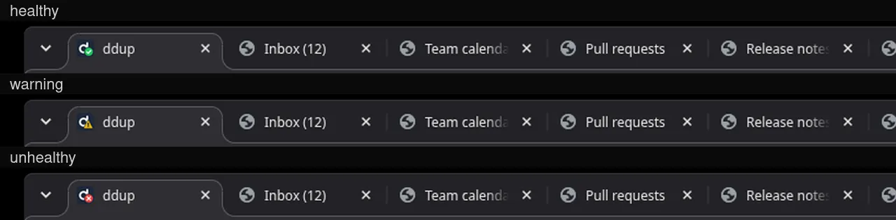

<div align="center">
  
</div>

# ddup - Dynamic DNS Health Checker

ddup periodically checks the health of your services and updates the DNS records pointing to healthy deployments.

You can use ddup to configure [round-robin DNS](https://en.wikipedia.org/wiki/Round-robin_DNS) for load balancing and failover, for internal or external apps, automatically excluding un-healthy replicas.

ddup is **not** a DNS server, instead it works with "dynamic" DNS servers. Currently, it supports these DNS providers:

- AWS Route53
- Azure DNS
- Cloudflare DNS
- Google Cloud DNS
- OVH

<picture>
  <source media="(prefers-color-scheme: dark)" srcset="screenshots/dashboard-dark.webp">
  
</picture>

The dashboard shows each endpoint's priority and whether it is published in DNS or on standby, CNAME and proxied targets, dynamic DNS records, failed check counts and errors.
It has a **Check now** button, auto-refresh controls, a summary bar, and a light, dark or system theme.
The browser tab icon shows the overall status, so it stays visible when many tabs are open and the title is cut off.
All the data in these images is sample data.




This fork adds leader election, the theme switcher and the endpoint rows of the dashboard: see [FORK.md](FORK.md) for each of them and for how they relate to upstream, and [UPSTREAM.md](UPSTREAM.md) for what has been submitted.

## Installation

### Using Docker/Podman

You can run ddup as a Docker/Podman container. Container images are available for Linux and support amd64, arm64, and armv7/armhf.

First, create a folder where you will store the configuration file `config.yaml`, for example `$HOME/.ddup`. You can then start ddup with:

```sh
# For podman, replace "docker run" with "podman run"
docker run \
  -d \
  --read-only \
  -v $HOME/.ddup:/etc/ddup:ro \
  ghcr.io/italypaleale/ddup:v0
```

> ddup follows semver for versioning. The command above uses the latest version in the 0.x branch. We do not publish a container image tagged "latest".

This fork's images are `ghcr.io/mrwulf/ddup`, tagged with the fork's releases (for example `0.6.0-fork.22`); see [UPSTREAM.md](UPSTREAM.md).

### Using Docker Compose

This is an example of a `docker-compose.yaml` for running ddup:

```yaml
version: "3.6"

services:
  ddup:
    image: "ghcr.io/italypaleale/ddup:v0"
    volumes:
      # Set the path on the host OS
      - "/path/to/ddup:/etc/ddup:ro"
    restart: "unless-stopped"
    read_only: true
    logging:
      driver: "json-file"
      options:
        max-file: "5"
        max-size: "20m"
```

### Start as standalone app

You can download the latest version of ddup from the [Releases](https://github.com/italypaleale/ddup/releases) page. Fetch the correct archive for your system and architecture, then extract the files and copy the `ddup` binary to `/usr/local/bin` or another folder.

Place the configuration for ddup in the `/etc/ddup` folder.

You will need to start ddup as a service using the process manager for your system.

For example, for Linux distributions based on **systemd** you can use the sample unit in [`ddup.service`](./ddup.service): copy this file to `/etc/systemd/system/ddup.service`.

Start the service and enable it at boot with:

```sh
sudo systemctl enable --now ddup
```

## Configuration

ddup requires a configuration file `config.yaml` in one of the following paths:

- The path defined in the `DDUP_CONFIG` env var
- `/etc/ddup/config.yaml`
- `$HOME/.ddup/config.yaml`
- Or in the same folder where the ddup binary is located

You can find an example of the configuration file, and a description of every option, in the [`config.sample.yaml`](/config.sample.yaml) file.

> A config file can reference other files to load secrets from, using `!file /path/to/file` or `!envfile /path/to/.env VAR_NAME`. See [go-kit's README](https://github.com/ItalyPaleAle/go-kit/blob/main/config/README.md) for more details.

## Configuration Options

### Global Settings

- `interval`: How often to perform health checks (e.g., "30s", "1m", "5m")
- `ipLookupURLs`: List of the services used to look up the public IP address of endpoints that use `ipLookupFamily` and don't have a list of their own. ddup has no built-in services. See [Dynamic DNS](#dynamic-dns)

### Domains and Endpoints

- `domains`: Array of domains to manage
  - `recordName`: The DNS record to update (e.g., "api.example.com")
  - `provider`: Name of the DNS provider (from the [`providers` map](#providers-configuration))
  - `ttl`: Time to live for DNS records. A short value is preferred to ensure faster failover from failed deployments. The default value is 120 (seconds, equivalent to 2 minutes)
  - `healthChecks`: Configuration for health checks
    - `timeout`: Request timeout (default: "3s")
    - `attempts`: Maximum number of consecutive attempts before considering the endpoint unhealthy (default: 2)
    - `recoverAfter`: Consecutive successful checks needed before an endpoint that was removed from DNS is added back (default: 1)
    - `method`: `GET` (default) or `HEAD`
    - `expectStatus`: Status code that means healthy: an exact code (like `204`) or `2xx` for any 2xx code. Default: `2xx`. Redirects are not followed
  - `endpoints`: Array of endpoints for this domain
    - `name`: Friendly name for the endpoint, used for logging (optional)
    - `url`: HTTP URL to check for health status. Optional for endpoints that use `ipLookupFamily`, which are then not health-checked
    - `ip`: The IPv4 or IPv6 address to include in DNS records when healthy. IPv4 addresses create A records and IPv6 addresses create AAAA records. Exactly one of `ip`, `cname` and `ipLookupFamily` is required
    - `cname`: A hostname to publish in a CNAME record when healthy, as an alternative to `ip`. Exactly one of `ip`, `cname` and `ipLookupFamily` is required. See [CNAME records and Cloudflare proxying](#cname-records-and-cloudflare-proxying)
    - `ipLookupFamily`: `4` or `6`. Instead of a fixed `ip`, ddup looks up the public IP address of the network it runs in and publishes it: `4` creates an A record and `6` an AAAA record. See [Dynamic DNS](#dynamic-dns). Exactly one of `ip`, `cname` and `ipLookupFamily` is required, unless the endpoint has its own `ipLookupURLs`: then `ipLookupFamily` defaults to `4`
    - `ipLookupURLs`: Optional, and not together with `ip` or `cname`. One or more services for this endpoint, which **replace** the top-level `ipLookupURLs` for it. See [Dynamic DNS](#dynamic-dns)
    - `priority`: Optional non-negative integer for priority (default: 0). Only the healthy endpoints with the lowest priority value are published, and if none of them are healthy ddup falls back to the next value. When the preferred endpoints are healthy again (after `recoverAfter`, if set), ddup goes back to them. Endpoints with the same priority are all published together. If no endpoint is healthy, DNS is left unchanged. Fork only: endpoints that are not published are still health-checked and shown as "standby" in the dashboard
    - `host`: Optional hostname to include in the requests, when the request is made to an IP address or to a hostname different from the desired one
    - `providerOptions`: Optional settings that apply only with a specific DNS provider, under a key named after the provider. Using one with a domain whose provider is different is a configuration error. The only one is `cloudflare`, with `proxied` (see below)

An endpoint with `cname` is health-checked through its own `url`, like any other endpoint, so `url` is required.
Two endpoints of the same domain can't publish the same IP address or hostname.

#### CNAME records and Cloudflare proxying

By default, ddup publishes A and AAAA records that point to the `ip` of each healthy endpoint.
An endpoint can set `cname` instead, to publish a CNAME record pointing to a hostname.
This is useful for a target that is only reachable by hostname, such as a [Cloudflare Tunnel](https://developers.cloudflare.com/cloudflare-one/connections/connect-networks/) (`<tunnel-id>.cfargotunnel.com`), which can only be reached through Cloudflare's proxy.

Cloudflare can also proxy a record, so traffic goes through Cloudflare instead of directly to your server.
This is set per endpoint with `providerOptions.cloudflare.proxied` (default `false`), and works with both `ip` and `cname`.

The example below publishes the VPS endpoints as plain A records, and falls back to a proxied CNAME for a Cloudflare Tunnel only when all of them are unhealthy:

```yaml
domains:
  - recordName: "app.example.com"
    provider: "my-cloudflare"
    endpoints:
      - name: "vps-us"
        url: "https://vps-us.example.com/health"
        ip: "192.0.2.10"
      - name: "vps-eu"
        url: "https://vps-eu.example.com/health"
        ip: "198.51.100.10"
      - name: "tunnel"
        url: "https://tunnel-health.example.com/health"
        cname: "0a1b2c3d.cfargotunnel.com"
        priority: 1
        providerOptions:
          cloudflare:
            proxied: true
```

The rules, which ddup checks when it starts:

- A CNAME record can't coexist with other records at the same name, so an endpoint with `cname` must be the only one with its `priority`. Use a different `priority` from the other endpoints, as in the example
- A set of records is either all proxied or all DNS-only, so all endpoints with the same `priority` must use the same value for `proxied`. Endpoints with different priorities can differ, as in the example, because only one priority is published at a time
- Proxied records use Cloudflare's automatic TTL, so the domain's `ttl` is ignored for them

Providers declare what they support, and ddup refuses to start if the configuration asks for more:

| Provider         | `cname` | `providerOptions.cloudflare` |
| ---------------- | ------- | ---------------------------- |
| AWS Route53      | No      | No                           |
| Azure DNS        | No      | No                           |
| Cloudflare DNS   | Yes     | Yes                          |
| Google Cloud DNS | No      | No                           |
| OVH              | No      | No                           |

When ddup switches between a CNAME record and A or AAAA records, it overwrites an existing record in place, so the name never ends up with no records.

### Dynamic DNS

An endpoint can follow the public IP address of the network ddup runs in (dynamic DNS), instead of having a fixed `ip`. Set `ipLookupFamily` to `4` or `6`: `4` creates an A record and `6` an AAAA record.

**ddup has no lookup service built in, and contacts none unless you configure it.** You list the services in `ipLookupURLs`. Whichever service you pick sees the public IP address of your network, which is what these services are for, plus the fact that a ddup client is asking. Use one you trust, or one you host yourself.

On every check ddup asks the services for the current public address and publishes it, and updates the record when it changes.

#### Services for all the endpoints

List the services at the top level of the configuration. Every dynamic endpoint that doesn't have a list of its own uses the entries with its family. This example uses Akamai and ipify, which you can copy:

```yaml
ipLookupURLs:
  - url: "https://whatismyip.akamai.com"
    family: 4
  - url: "https://api.ipify.org"
    family: 4
  - url: "https://api6.ipify.org"
    family: 6

domains:
  - recordName: "home.example.com"
    provider: "example-provider-1"
    ttl: 300
    endpoints:
      # Asks the two services with family 4, at the same time
      - name: "home"
        ipLookupFamily: 4
      # Asks the service with family 6
      - name: "home-v6"
        ipLookupFamily: 6
```

#### Services for one endpoint

An endpoint with `ipLookupFamily` can have its own `ipLookupURLs`, with one or more entries. This is how you give one record several lookup URLs:

```yaml
domains:
  - recordName: "office.example.com"
    provider: "example-provider-1"
    ttl: 300
    endpoints:
      - name: "office"
        ipLookupFamily: 4
        # These two services are asked at the same time, and the first valid answer is used
        # This list replaces the top-level ipLookupURLs for this endpoint
        ipLookupURLs:
          - url: "https://ip.example.com/v4"
          - url: "https://ip2.example.com/plain"
```

Different endpoints can have different lists, also in the same domain.

This is also how an endpoint gets its address from something other than a public service. The URL can be anything that answers with just an IP address, for example a script on a server you own or a page on your router. It needs to use `https`.

#### Rules

- The list of an endpoint **replaces** the top-level list for that endpoint. They are never merged: the top-level services are not contacted for it.
- An endpoint's list can have one entry or several. All the services that apply to an endpoint (all the entries of its own list, or all the top-level entries with its family) are asked at the same time. With one entry, only that service is asked.
- At the top level, `family` (`4` or `6`) says which IP version the service answers for. It defaults to `4`.
- In an endpoint's list, `family` is optional, because `ipLookupFamily` already says it. If the endpoint sets neither `ip` nor `ipLookupFamily`, `ipLookupFamily` is `4`. If it is set, it must be equal to `ipLookupFamily`: ddup refuses a configuration that mixes IPv4 and IPv6 services for one endpoint.
- An endpoint with `ipLookupFamily` needs at least one service, from its own list or from a top-level entry with its family. Otherwise the configuration is rejected, and the message says what to add. An empty list (`ipLookupURLs: []`) on an endpoint is rejected as well.
- `ipLookupURLs` on an endpoint with a fixed `ip` is rejected, because it would never be used.
- `url` must use `https`. An answer that can't be authenticated could be spoofed, and ddup would publish it.
- A service must answer with just the IP address, as plain text.

#### How the lookup works

- With no `url` the endpoint isn't health-checked: it's healthy as long as the lookup works. With a `url`, the endpoint is also health-checked as usual, and the address that was looked up is the one published.
- Requests are made over the requested IP version only, so a service sees (and returns) an address of that family.
- The first valid answer is used. The other services finish in the background, and ddup logs a warning if they return a different address. A service that fails or returns something that is not valid is skipped; if all of them fail, the lookup fails, the endpoint is unhealthy, and DNS is left as it is until an address is found (like any other unhealthy endpoint).
- An answer is rejected unless it is just an IP address of the right family: an IPv4 address for `ipLookupFamily: 4` and an IPv6 address for `6`. Loopback, private, carrier-grade NAT (`100.64.0.0/10`), link-local, multicast and unspecified addresses are rejected too. Responses are limited to 4 KB, redirects are not followed, and each service has the health check `timeout` to answer.
- Requests use the proxy settings of the environment, like any other request, and every lookup opens a new connection, so the answer always reflects the current network path.
- If two endpoints end up with the same address, it is published once.
- ddup replaces every `A`/`AAAA` record at the name that isn't the looked-up address, so don't point it at a name that has other records.

Any service that answers with the caller's address works, including a few lines on a VPS you own that echo the client address.

### Providers Configuration

- `providers`: Map of providers.
  - Key: provider name (e.g. `my-provider-1`)
  - Value: an object containing a provider configuration, which is one (and only one) of:
    - [`awsRoute53`](#aws-route53-provider-settings)
    - [`azure`](#azure-provider-settings)
    - [`cloudflare`](#cloudflare-provider-settings)
    - [`googleCloudDns`](#google-cloud-dns-provider-settings)
    - [`ovh`](#ovh-provider-settings)

#### AWS Route53 Provider Settings

Required settings:

- `hostedZoneId`: ID of the hosted zone (e.g. `Z0123456789ABCDEFGHIJ`)

Optional settings, to authenticate with an IAM user's access key:

- `accessKeyId`: Access key ID
- `secretAccessKey`: Secret access key

If these are not set, ddup uses the [default AWS credential chain](https://docs.aws.amazon.com/sdkref/latest/guide/standardized-credentials.html), which includes environmental variables such as `AWS_ACCESS_KEY_ID` and `AWS_SECRET_ACCESS_KEY`, shared config and credentials files (selected with `AWS_PROFILE`), IAM Roles for Service Accounts on EKS, ECS task roles, and EC2 instance profiles.

The principal needs an IAM policy that allows listing and changing record sets in the hosted zone:

```json
{
  "Version": "2012-10-17",
  "Statement": [
    {
      "Effect": "Allow",
      "Action": [
        "route53:ListResourceRecordSets",
        "route53:ChangeResourceRecordSets"
      ],
      "Resource": "arn:aws:route53:::hostedzone/<hosted-zone-id>"
    }
  ]
}
```

To restrict the record names ddup can change, add a condition on the `route53:ChangeResourceRecordSetsNormalizedRecordNames` key.

Example:

```yaml
providers:
  example-provider-1:
    awsRoute53:
      hostedZoneId: "Z0123456789ABCDEFGHIJ"
```

#### Azure Provider Settings

Required settings:

- `subscriptionId`: ID of the Azure subscription where the DNS Zone is deployed
- `resourceGroupName`: Name of the Resource Group containing the DNS Zone resource
- `zoneName`: Name of the DNS Zone, which corresponds to the domain name (e.g. `example.com`)

The other settings depend on the authentication method:

- The default authentication method automatically attempts a number of supported methods, including Managed Identity, Workload Identity, Azure CLI credentials (in development), etc. You can also configure it with environmental variables including `AZURE_CLIENT_ID`, `AZURE_TENANT_ID`, `AZURE_CLIENT_SECRET` ([full reference](https://pkg.go.dev/github.com/Azure/azure-sdk-for-go/sdk/azidentity#readme-environment-variables))
- To use a service principal (with client ID and client secret), set these options:
  - `clientId`: Client ID
  - `clientSecret`: Client Secret
  - `tenantId`: Tenant ID
- To use a user-assigned managed identity, set:
  - `managedIdentityClientId`: Client ID of the user-assigned managed identity

Regardless of the authentication method, ensure that the principal (user, service principal, or managed identity) has the **DNS Zone Contributor** role assigned to the DNS zone.

If using a custom RBAC role instead, ensure it includes permissions for both IPv4 and IPv6 DNS records:

```text
Microsoft.Network/dnsZones/A/read
Microsoft.Network/dnsZones/A/write
Microsoft.Network/dnsZones/A/delete
Microsoft.Network/dnsZones/AAAA/read
Microsoft.Network/dnsZones/AAAA/write
Microsoft.Network/dnsZones/AAAA/delete
```

Using the Azure CLI, the built-in **DNS Zone Contributor** role can be assigned with:

```sh
az role assignment create \
  --assignee <client-id> \
  --role "DNS Zone Contributor" \
  --scope "/subscriptions/<subscription-id>/resourceGroups/<rg-name>/providers/Microsoft.Network/dnsZones/<zone-name>"
```

Example:

```yaml
providers:
  example-provider-1:
    azure:
      subscriptionId: "00000000-0000-0000-0000-000000000000"
      resourceGroupName: "my-dns-rg"
      zoneName: "example.com"
```

#### Cloudflare Provider Settings

Required settings:

- `zoneId`: Cloudflare Zone ID for your domain
- `apiToken`: Cloudflare API token with permission to edit DNS records in that zone (see below)

To get the credentials:

- API Token: Go to Cloudflare dashboard → My Profile → API Tokens → Create Token → Create Custom Token
  - Permissions: **Zone → DNS → Edit** (this is the only permission ddup needs)
  - Zone Resources: **Include → Specific zone →** your domain
  - It must be an API token (sent as a Bearer token), not the Global API Key
- Zone ID: Found on the domain's Overview page, in the right sidebar

Cloudflare cannot scope a token to a single record, so the token can edit every DNS record in the zone. Use a token dedicated to ddup rather than sharing one with other tools.

Records are created DNS-only (not proxied by Cloudflare), unless the endpoint sets [`providerOptions.cloudflare.proxied`](#cname-records-and-cloudflare-proxying). The same token permission is enough for CNAME and proxied records.

Example:

```yaml
providers:
  example-provider-1:
    cloudflare:
      apiToken: "your-cloudflare-api-token"
      zoneId: "your-zone-id"
```

#### Google Cloud DNS Provider Settings

Required settings:

- `projectId`: ID of the Google Cloud project containing the managed zone
- `managedZone`: Name of the managed zone resource (e.g. `my-zone`), which is not the same as its DNS name

Optional settings:

- `credentialsFile`: Path to a service account key file (JSON)

If `credentialsFile` is not set, ddup uses [Application Default Credentials](https://cloud.google.com/docs/authentication/application-default-credentials), which include the `GOOGLE_APPLICATION_CREDENTIALS` environment variable, the attached service account when running on Google Cloud (including GKE Workload Identity), Workload Identity Federation, and credentials from `gcloud auth application-default login` (in development).

The principal needs the **DNS Administrator** role (`roles/dns.admin`), which can be granted on the managed zone alone. If using a custom role instead, it needs these permissions:

```text
dns.changes.create
dns.resourceRecordSets.list
dns.resourceRecordSets.create
dns.resourceRecordSets.update
dns.resourceRecordSets.delete
```

Example:

```yaml
providers:
  example-provider-1:
    googleCloudDns:
      projectId: "my-project"
      managedZone: "my-zone"
```

#### OVH Provider Settings

Required settings:

- `apiKey`: API key
- `apiSecret`: API secret
- `consumerKey`: Consumer key
- `zoneName`: Name of the zone (e.g. `example.com`)

Optional settings:

- `endpoint`: OVH API endpoint, which is one of:
  - `"eu"` (default value if omitted)
  - `"ca"`
  - `"us"`
  - A custom URL

To get the required credentials, navigate to this URL, replacing `{zoneName}` with the name of your zone (e.g. `example.com`):

```text
https://api.ovh.com/createToken/index.cgi?GET=/domain/zone/{zoneName}/*&POST=/domain/zone/{zoneName}/*&DELETE=/domain/zone/{zoneName}/*
```

Example:

```yaml
providers:
  ovh-eu-example:
    ovh:
      apiKey: "your-ovh-api-key"
      apiSecret: "your-ovh-api-secret" 
      consumerKey: "your-ovh-consumer-key"
      zoneName: "example.com"
      endpoint: "eu"
```

### Notifications

ddup can notify you when something happens to a domain. Notifications are optional: with no `notifications` section, ddup sends nothing.

Notifications can be sent to webhooks (plain text, Slack, Discord, or [ntfy](https://ntfy.sh)), and by email.
The messages are built by ddup and are not customizable.

#### Events

| Event | When it is sent |
| :---- | :-------------- |
| `dns_updated` | The DNS records of a domain were changed. The message has the addresses published now and the ones that were in DNS before |
| `dns_update_failed` | Updating the DNS records of a domain failed. The message has the error. ddup retries at every check, and the same error is notified only once |
| `all_unhealthy` | A domain has no healthy endpoint. DNS is left unchanged. It is sent once, when the domain enters this state (including at startup), and not on every check |

When a domain recovers after `all_unhealthy`, ddup updates DNS as usual and sends `dns_updated`. If the records in DNS are already the right ones, nothing changed and no event is sent.

Every notification has an optional `events` list to choose the events to receive. If omitted, it receives all events.

#### Settings

- `notifications`: Notifications to send
  - `webhooks`: List of webhooks
    - `name`: Name of the notification, used in logs. Required, and unique among the `webhooks` entries
    - `format`: `plain` (default, the message as plain text), `slack` (a Slack-compatible message), `discord` (Discord's Slack-compatible endpoint), or `ntfy` (a message for an [ntfy](https://ntfy.sh) topic)
    - `url`: URL of the webhook. Required. For `ntfy`, it includes the topic name, such as `https://ntfy.example.com/ddup`
    - `token`: Optional token, sent as `Authorization: Bearer <token>`. Some formats do not use it
    - `events`: Events to send (default: all)
  - `email`: List of email notifications
    - `name`: Name of the notification, used in logs. Required, and unique among the `email` entries
    - `connectionString`: Connection string for the email provider. Required. The supported providers are Resend (`resend://<api-key>?fromAddress=<address>&fromName=<name>`), SMTP (`smtp://<username>:<password>@<host>:<port>?fromAddress=<address>&fromName=<name>&tls=<auto|starttls|implicit|none>`), AWS SES (`awsses://<access-key-id>:<secret-access-key>@<region>?fromAddress=<address>&fromName=<name>`), SendGrid, and `console://` (logs the email instead of sending it, for development). See [go-kit's documentation](https://github.com/ItalyPaleAle/go-kit/tree/main/emailer) for all options
    - `to`: List of recipients. One email is sent to each address. Required
    - `events`: Events to send (default: all)
  - `detail`: Add the status emoji, the priority tiers and the error of each unhealthy endpoint to every message (default: `true`). Set it to `false` for the messages shown in [Messages](#messages). This is a fork extension (see [FORK.md](FORK.md#detailed-notifications))

`webhooks` entries also have these optional settings for delivering the request:

- `timeout`: Timeout of each request (default: `20s`)
- `maxAttempts`: Maximum number of attempts to send each notification, including the first (default: 3). Network errors and `408`, `429` and `5xx` responses are retried, while other errors are not. Set it to `1` to disable retries
- `retryInterval`: Delay between attempts (default: `20s`)
- `allowPrivateDestinations`: By default, ddup refuses to send notifications to private and non-routable addresses (such as `10.x.x.x`, `192.168.x.x`, link-local addresses, and `localhost`). This keeps a webhook URL that points to an internal service from being used to reach it. Set it to `true` when the destination is on a trusted internal network, for example an ntfy server in your LAN or cluster (default: `false`)

Redirects are never followed.
Emails are sent once, without retries.

The URLs and tokens of webhooks, and the email connection strings, are secrets. Read them from files with `!file` (see [Configuration](#configuration)), so the configuration file does not contain them. ddup never writes these values to its logs: notification failures are logged with the `name` of the notification and the error, with the URL and secrets removed.

#### Examples

Send all events to an ntfy topic on a server in a private network:

```yaml
notifications:
  webhooks:
    - name: "alerts"
      format: "ntfy"
      url: "https://ntfy.example.com/ddup"
      token: !file /run/secrets/ntfy-token
      allowPrivateDestinations: true
```

Send the events about problems to a Slack channel, and all events to a Discord channel:

```yaml
notifications:
  webhooks:
    - name: "slack-alerts"
      format: "slack"
      url: !file /run/secrets/slack-webhook-url
      events: ["dns_update_failed", "all_unhealthy"]
    - name: "discord"
      format: "discord"
      url: !file /run/secrets/discord-webhook-url
```

Send emails with Resend, or with an SMTP server (the file contains the whole connection string, such as `resend://<api-key>?fromAddress=ddup@example.com&fromName=ddup`):

```yaml
notifications:
  email:
    - name: "ops-resend"
      connectionString: !file /run/secrets/resend-connection-string
      to: ["postmaster@example.com"]
      events: ["dns_update_failed", "all_unhealthy"]
    - name: "ops-smtp"
      # smtp://ddup:<password>@smtp.example.com:587?fromAddress=ddup@example.com&tls=starttls
      connectionString: !file /run/secrets/smtp-connection-string
      to: ["postmaster@example.com", "oncall@example.com"]
```

#### Delivery

Notifications are sent in the background, so a slow or unavailable destination never delays a health check. Each notification has its own queue of up to 64 events: if a destination cannot keep up, the oldest events are delivered first and the newest are dropped, with a warning in the logs. When ddup stops, it waits a few seconds for queued notifications to be delivered.

When ddup starts, it checks the settings of every notification (including the email connection strings), and exits with an error if one is invalid.

#### Messages

Every message has a title and a body. The title is the subject of emails and the title of ntfy notifications. The body is the same for all kinds, and Slack and Discord messages are the title and the body in one text.

The ntfy notifications also set the tags `green_circle`, `yellow_circle`, or `red_circle` for the health of the domain (all, some, or none of its endpoints are healthy), and `warning` for `dns_update_failed` and `all_unhealthy`. The priority is `urgent` (5) for `all_unhealthy` and `high` (4) for `dns_update_failed`, and the default of the ntfy server for `dns_updated`.

`dns_updated`, as an ntfy notification (title, tags, then the body):

```text
Title: example.com now points to 192.0.2.10, 192.0.2.11
Tags: green_circle

Event: dns_updated
Domain: example.com
Time: 2026-01-02T03:04:05Z
Status: healthy
Now: 192.0.2.10, 192.0.2.11
Before: 192.0.2.12

Endpoints:
  server1 (192.0.2.10): healthy
  server2 (192.0.2.11): healthy
  server3 (192.0.2.12): healthy
```

`dns_update_failed`, as an email (the subject, then the text):

```text
Subject: DNS update failed for example.com

Event: dns_update_failed
Domain: example.com
Time: 2026-01-02T03:04:05Z
Status: unhealthy
Wanted: 192.0.2.10, 192.0.2.11
Before: 192.0.2.12
Error: provider returned status 500

Endpoints:
  server1 (192.0.2.10): healthy
  server2 (192.0.2.11): healthy
  server3 (192.0.2.12): UNHEALTHY
```

`all_unhealthy`, as a Slack or Discord message:

```text
No healthy endpoints for example.com

Event: all_unhealthy
Domain: example.com
Time: 2026-01-02T03:04:05Z
Status: unhealthy
Unchanged: 192.0.2.10, 192.0.2.11

Endpoints:
  server1 (192.0.2.10): UNHEALTHY
  server2 (192.0.2.11): UNHEALTHY
```

#### Detailed messages

With `detail: true` (the default in this fork), the messages carry more than the examples above:

- Titles name the endpoints instead of listing their addresses: `example.com now points to server1, server2` for `dns_updated`, and `DNS update failed for example.com (wanted server1)` for `dns_update_failed`. An endpoint without a `name` is shown by its address, because its default name is the URL of its health check, which can contain a token. The same goes for the list of endpoints in the body.
- The title starts with a green, yellow or red circle for the status of the domain (all, some, or none of the endpoints are healthy), and so does the `Status` line. ntfy titles have no circle, because ntfy shows the status tag before the title.
- When the domain has more than one priority, each endpoint shows its priority, and a healthy endpoint that is not published is marked `standby`. A `dns_updated` that moves to another tier has a `Priority: <new> (was <old>)` line.
- An unhealthy endpoint shows the error of its latest check. The URL of the endpoint is removed from it (it can contain a token), and so are the secrets of the configuration. Long errors are cut at 200 characters.

`dns_updated` when the primary tier recovers, as a Slack message:

```text
🟡 example.com now points to server1

Event: dns_updated
Domain: example.com
Time: 2026-01-02T03:04:05Z
Status: 🟡 warning
Now: 192.0.2.10
Before: 192.0.2.20
Priority: 0 (was 1)

Endpoints:
  server1 (192.0.2.10, priority 0): healthy
  server2 (192.0.2.11, priority 0): UNHEALTHY (HTTP request failed: dial tcp 192.0.2.11:443: connect: connection refused)
  backup (192.0.2.20, priority 1): healthy (standby)
```

The titles of the same domain for the other events, where `192.0.2.30` is an endpoint without a `name`:

```text
DNS update failed for example.com (wanted server1, 192.0.2.30)
No healthy endpoints for example.com
```

In ntfy these titles have no circle; in emails and webhooks they start with one.

### Leader Election

By default ddup is a single instance. On Kubernetes you can run several replicas with `leaderElection`: all of them run the health checks and keep their own state, but only the leader updates DNS and sends notifications, so a replica that takes over finds a warm state. The leader is decided with a `Lease` object.

- `enabled`: Enable leader election (disabled by default)
- `name`: Name of the Lease (defaults to `ddup`)
- `namespace`: Namespace of the Lease (defaults to the namespace of the pod)
- `identity`: Unique ID of the replica (defaults to `$POD_IP`, then `$POD_NAME`, then the hostname)
- `leaseDuration`, `renewDeadline`, `retryPeriod`: Timing of the election (defaults to `15s`, `10s` and `2s`; each must be longer than the next). A new leader is elected within about `leaseDuration` after the old one crashes, and right away when the leader shuts down cleanly

The service account of the pod needs the permission to `get`, `create` and `update` Leases in the namespace.

What changes with several replicas:

- Only the leader calls the DNS provider and sends notifications. A standby logs `Not the leader, skipping DNS update` at the debug level.
- When a replica becomes the leader, it publishes the current records again for every domain, in case the old leader stopped in the middle of a change. If the records are already right nothing changes, and no `dns_updated` notification is sent.
- A domain with no healthy endpoints is announced once. The standbys note the outage without announcing it, so a new leader that takes over during the outage does not send `all_unhealthy` a second time. If the old leader stopped before announcing the outage, nobody announces it, but the recovery is still reported by `dns_updated`.
- A `dns_update_failed` notification is sent once for each distinct error by the leader that saw it. A new leader sends its own if it hits the same error.
- Every replica makes its own health checks, so the `since`, `sinceStart` and `lastFailure` times of an endpoint are when that replica saw the change, and `failureCount` is its own count.
- The API requests (`/api/status`, `/api/check`) that a standby receives are forwarded to the leader, so everyone sees the leader's view and "Check now" runs where it matters. Forwarding needs the identity to be the IP address of the pod, and only works to the port of `server`. If the leader is unknown or can't be reached, the standby answers with its own view. The page and `/healthz` are always served by the replica that receives the request.
- The forwarded response carries the `X-Ddup-Build` header of the replica that forwarded it, not the leader's. During a rolling update the leader can run an older build than the standby that served the page, and the dashboard must compare its own build with the one that served it: with the leader's build it would reload the page for a build that the next request could not give it. The dashboard also limits how often it reloads for the same build.

### Server Settings

- `enabled`: Enable the server (disabled by default)
- `bind`: Address to bind to (defaults to `127.0.0.1`)
- `port`: Port to listen on (defaults to `7401`)

The server has no authentication, so keep it on a trusted network. It exposes:

- `GET /api/status` and `GET /api/status/{recordname}`: current status of the domains. Each endpoint has its `ip` (the IP address, or the hostname for an endpoint with `cname`), and the optional `name` (when the endpoint has one other than its URL), `type` of its DNS record (`A`, `AAAA` or `CNAME`), `proxied`, `priority`, `active` (the endpoint is published in DNS: it is healthy and has the lowest priority among the healthy endpoints) and `failureCount`. The last three are left out when they are false or 0
  Each endpoint also has the optional fields `since` (when it last changed between healthy and unhealthy), `lastFailure` (the last time a check of it failed, kept after it recovers) and `sinceStart` (true when `since` is only the time of the first check after ddup started, because the real time is not known). For failed checks it also has `lastError` (the error of the last failed check), and `firstFailure` (the time of the first failed check of the current run of failures, left out once a check passes again). With `failureCount`, which counts the failed checks in a row, they show why an endpoint is in the warning state, where it failed some checks but is still healthy. They are kept in memory, so they start again when ddup restarts, and they are left out when they are not known
- `POST /api/check`: runs health checks for all domains right away (the dashboard's "Check now" button), and returns the updated status. The request must include the header `X-Requested-By: ddup-dashboard`, which keeps other websites from triggering it through a visitor's browser. If a check finished less than 5 seconds ago, no new one is run. A forced check counts towards `attempts` and `recoverAfter` like a scheduled one, and the next scheduled check is then a full `interval` later
- `GET /healthz`: returns 204 when the server is up

### Logging Settings

- `log`: Logging options
  - `level`: Controls log level and verbosity. Supported values: `debug`, `info` (default), `warn`, `error`.
  - `json`: If true, emits logs formatted as JSON, otherwise uses a text-based structured log format. Defaults to false if a TTY is attached (e.g. when running the binary directly in the terminal or in development); true otherwise.

## Development

To build, run and test ddup from source, see [DEVELOPMENT.md](./DEVELOPMENT.md).
